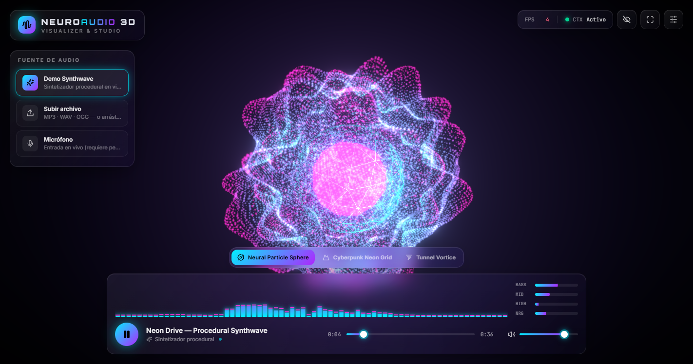
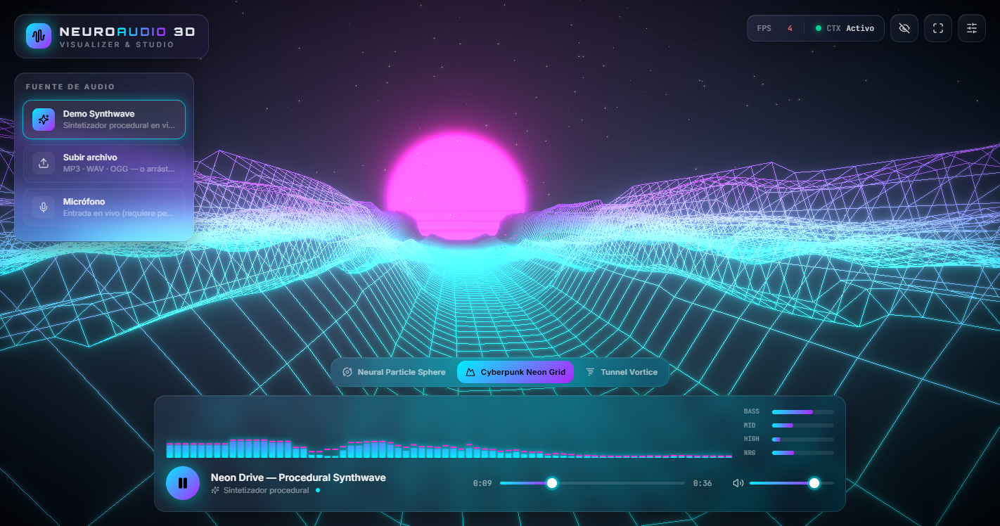
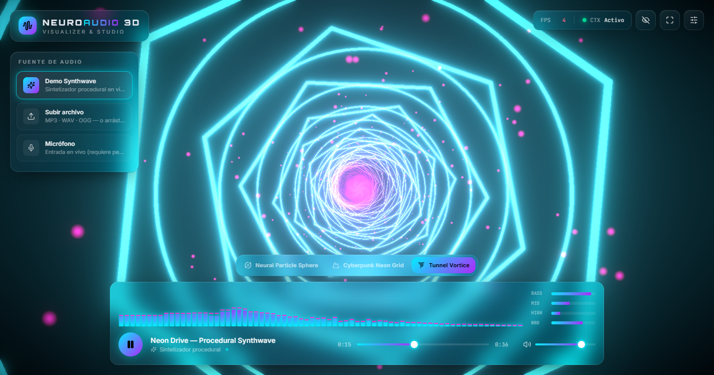
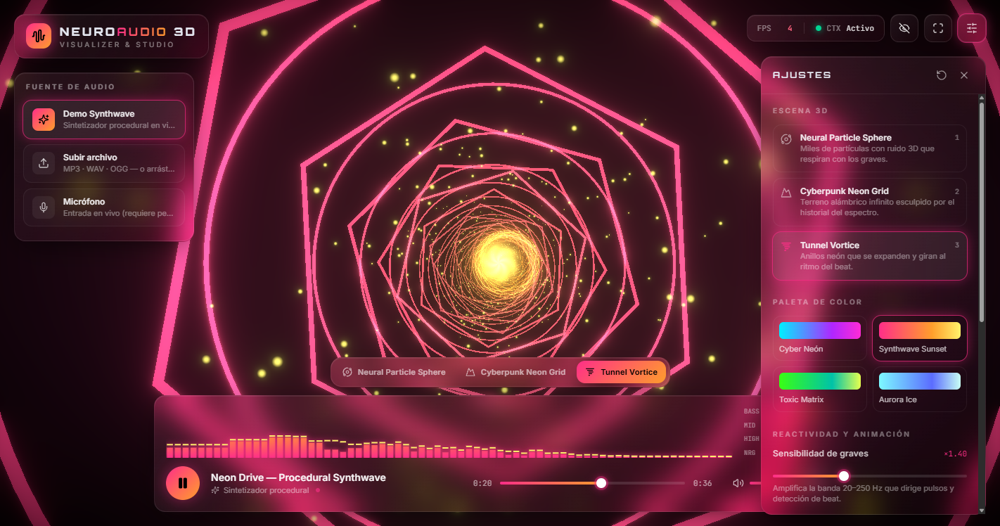
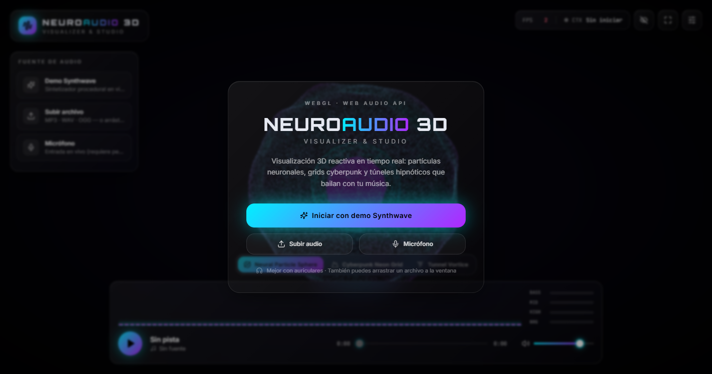

<div align="center">

# 🧠🎧 NeuroAudio 3D — Visualizer & Studio

**Visualizador de audio 3D reactivo en tiempo real, construido con WebGL, Three.js y la Web Audio API nativa.**

[](https://react.dev)
[](https://www.typescriptlang.org)
[](https://vite.dev)
[](https://threejs.org)
[](https://docs.pmnd.rs/react-three-fiber)
[](https://tailwindcss.com)
[](https://developer.mozilla.org/docs/Web/API/Web_Audio_API)
[](./LICENSE)



</div>

---

## ✨ Descripción

**NeuroAudio 3D** convierte cualquier sonido en una experiencia audiovisual inmersiva. Un `AnalyserNode` (FFT 2048) descompone la señal en tiempo real en **graves, medios, agudos, energía RMS y beats**, y esos datos dirigen shaders GLSL personalizados, iluminación dinámica y post-procesado (bloom, aberración cromática) a 60 FPS.

Funciona **al instante sin descargar nada**: incluye un **sintetizador synthwave procedural** generado 100 % con nodos de Web Audio (bombo, caja, hi-hats, bajo, pads con sidechain y arpegiador con delay).

## 📸 Capturas

| Neural Particle Sphere | Cyberpunk Neon Grid |
| :---: | :---: |
|  |  |
| **Tunnel Vortice** | **Panel de ajustes + paleta Synthwave Sunset** |
|  |  |

<details>
<summary>Pantalla de inicio (gesto de usuario para la política de autoplay)</summary>

</details>

## 🚀 Características principales

### 🎛️ Procesamiento de audio en tiempo real
- **`AudioContext` + `AnalyserNode`** (FFT 2048 → 1024 bins) con extracción de bandas por rangos de Hz reales: graves (20–250 Hz), medios (250 Hz–4 kHz) y agudos (4–16 kHz).
- **Seguidores de envolvente** (ataque rápido / release lento) para visuales enérgicos sin parpadeo.
- **Detección de beats adaptativa** sobre ~1 s de historial de graves con *cooldown*.
- **Tres fuentes de entrada**:
  - 🎹 **Demo synthwave procedural** — progresión i–VI–III–VII en La menor, programada con el patrón *lookahead scheduler* para timing preciso aunque el hilo principal esté ocupado renderizando WebGL.
  - 📁 **Archivos locales** (MP3, WAV, OGG, M4A, FLAC) mediante selector o **drag & drop** en toda la ventana.
  - 🎙️ **Micrófono en vivo** con permiso explícito; se enruta solo al analizador (nunca a los altavoces) para evitar acoples.
- **Transporte completo**: Play/Pause, barra de progreso con *seek*, volumen con mute y **ecualizador visual** de 72 bandas logarítmicas con *peak caps* + medidores BASS / MID / HIGH / NRG.

### 🌌 Visualización 3D reactiva
| Escena | Técnica |
| --- | --- |
| **Neural Particle Sphere** | 32 000 partículas (esfera de Fibonacci + nube interna) desplazadas en el *vertex shader* con ruido simplex 3D; los graves deforman, los agudos hacen vibrar y los medios retuercen. Núcleo icosaédrico metálico iluminado por luces dinámicas. |
| **Cyberpunk Neon Grid** | Retícula de líneas infinita cuyo relieve se lee de una **`DataTexture` de historial del espectro** (frecuencia × tiempo): las ondas se propagan hacia el horizonte. Sol retro con franjas animadas y campo de estrellas. |
| **Tunnel Vortice** | 56 anillos (círculos + hexágonos) con **`InstancedMesh`** —2 *draw calls*—, cada uno escuchando su propia porción del espectro; trayectoria curva, partículas *warp* en GPU y portal con *swirl* al fondo. |

- **OrbitControls** con límites por escena, rotación automática y **efectos de cámara al beat** (FOV kick, micro-sacudida sin acumulación de deriva, aberración cromática).
- **Bloom (mipmap blur)** cuya intensidad sigue la energía y el beat, viñeta y **luces puntuales orbitales** que cambian de color e intensidad con graves y agudos.
- **4 paletas neón** (Cyber Neón, Synthwave Sunset, Toxic Matrix, Aurora Ice) con transiciones suaves: los *uniforms* de los shaders referencian los mismos objetos `Color`, que se interpolan una sola vez por frame.

### 💎 UI / UX
- Dark mode futurista con **glassmorphism** oscuro y acentos neón que siguen la paleta activa (CSS custom properties).
- **Panel de ajustes retráctil**: escena, paleta, sensibilidad de graves, velocidad de animación, intensidad de bloom, rotación automática y efectos de cámara (persistidos en `localStorage`).
- **HUD** con FPS reales del render loop, estado del `AudioContext` y nombre de la pista.
- **Atajos de teclado**: `Espacio` play/pausa · `1` `2` `3` escenas · `P` paleta · `S` ajustes · `H` ocultar UI (modo captura) · `F` pantalla completa.

### 🧹 Calidad de código y ciclo de vida
- **TypeScript estricto** (`strict`, `noUnusedLocals`, `noUncheckedSideEffectImports`…) y **cero `any`**.
- `AudioContext` creado **solo tras un gesto del usuario** (política de autoplay), **suspendido al pausar** y al ocultar la pestaña, **reanudado** al volver, y **cerrado** al desmontar.
- Liberación explícita de recursos: `dispose()` de geometrías, materiales y texturas al cambiar de escena (`useDisposable`), `cancelAnimationFrame` en todos los bucles, `URL.revokeObjectURL`, parada de pistas del micrófono y desconexión de nodos de audio al terminar cada nota.
- **Cero asignaciones por frame** en los caminos calientes (buffers compartidos y objetos *scratch* reutilizados).
- Compatible con **React StrictMode** (el motor de audio se crea en un efecto, no durante el render).

## 🧰 Stack técnico

| Capa | Tecnologías |
| --- | --- |
| UI | React 19, TypeScript 5.8, Tailwind CSS v4, Lucide React |
| 3D | Three.js r178, @react-three/fiber v9, @react-three/drei v10, @react-three/postprocessing v3, GLSL |
| Audio | Web Audio API nativa (`AudioContext`, `AnalyserNode`, `OscillatorNode`, `BiquadFilterNode`, `DynamicsCompressorNode`, `DelayNode`, `MediaElementAudioSourceNode`, `MediaStreamAudioSourceNode`) |
| Tooling | Vite 7, `tsc -b` con project references |

## 🏗️ Arquitectura modular

```
src/
├── audio/                   # Núcleo de audio, sin dependencias de React
│   ├── AudioEngine.ts       # Grafo de audio, fuentes, transporte y ciclo de vida del AudioContext
│   ├── FeatureExtractor.ts  # FFT → bass/mid/treble/energy + detección de beats
│   ├── SynthwaveSynth.ts    # Sintetizador procedural con lookahead scheduler
│   └── types.ts
├── scenes/                  # Mundo 3D (React Three Fiber)
│   ├── SceneRoot.tsx        # <Canvas>, orquestación de escenas y efectos
│   ├── ParticleSphere.tsx   # Escena 1 — shader de partículas con ruido simplex
│   ├── NeonTerrain.tsx      # Escena 2 — grid + DataTexture de historial espectral
│   ├── TunnelVortex.tsx     # Escena 3 — InstancedMesh + partículas warp
│   ├── CameraRig.tsx        # OrbitControls + FOV kick / shake al beat
│   ├── DynamicLights.tsx    # Luces puntuales reactivas
│   ├── PostFX.tsx           # Bloom, aberración cromática, viñeta
│   ├── FrameDrivers.tsx     # Muestreo de audio por frame (prioridad -2) + medidor de FPS
│   ├── animatedPalette.ts   # Colores vivos compartidos por todos los shaders
│   ├── cameraPresets.ts     # Encuadre y límites de órbita por escena
│   ├── useDisposable.ts     # useMemo + dispose() garantizado
│   └── shaders/noise.ts     # Ruido simplex 3D (GLSL)
├── components/              # Interfaz (glassmorphism)
│   ├── TopBar.tsx · SourcePanel.tsx · TransportBar.tsx · SpectrumAnalyzer.tsx
│   ├── SettingsPanel.tsx · SceneSwitcher.tsx · StartOverlay.tsx · DropOverlay.tsx · Toast.tsx
│   └── ui/                  # Slider, Toggle, IconButton
├── hooks/                   # useAudioEngine, useAnimationFrame, usePlaybackPosition,
│                            # useFileDrop, useKeyboardShortcuts, usePersistentState
├── config/                  # Paletas, escenas y ajustes por defecto
└── utils/                   # Formateo de tiempo, className helper
```

### Flujo de datos por frame

```
          ┌──────────── fuentes ────────────┐
          │ Synth procedural │ <audio> │ Mic │
          └────────┬─────────────────────────┘
                   ▼
   inputBus ─► AnalyserNode (FFT 2048) ─► monitor ─► volumen ─► altavoces
                   │                         (0 para micrófono)
                   ▼
  useFrame(prioridad -2) → FeatureExtractor.update()  → AudioFeatures (objeto compartido, mutado in-place)
                   │
     ┌─────────────┼───────────────┬──────────────┬─────────────────┐
     ▼             ▼               ▼              ▼                 ▼
  uniforms      InstancedMesh   CameraRig      PostFX (bloom)   EQ 2D canvas (rAF propio)
  de shaders    (túnel)         (FOV/shake)    intensidad       + medidores DOM
```

El análisis se ejecuta **una sola vez por frame**, antes que los controles (prioridad -1) y las escenas (0); todos los consumidores leen el mismo objeto sin re-renders de React.

## ⚙️ Instalación y ejecución

**Requisitos:** Node.js ≥ 20.19 (recomendado 22 LTS o superior) y un navegador con WebGL2.

```bash
# 1. Clonar el repositorio
git clone https://github.com/lecarnaquemauricioangel-cmd/neuroaudio-3d-visualizer.git
cd neuroaudio-3d-visualizer

# 2. Instalar dependencias
npm install

# 3. Servidor de desarrollo → http://localhost:5173
npm run dev
```

| Script | Descripción |
| --- | --- |
| `npm run dev` | Servidor de desarrollo con HMR |
| `npm run build` | Comprobación de tipos + build de producción en `dist/` |
| `npm run typecheck` | Solo comprobación de tipos |
| `npm run preview` | Sirve el build de producción localmente |

> 🎙️ El micrófono requiere un **contexto seguro** (`localhost` o HTTPS). Para probar desde el móvil en red local usa HTTPS (p. ej. desplegando en Vercel/Netlify).

## 🗺️ Ideas futuras
- Exportación de vídeo del canvas (`MediaRecorder` + `captureStream`).
- Detección de BPM y sincronización de cortes de cámara.
- Más escenas (fluidos GPGPU, metaballs con ray marching).
- Integración con Spotify / SoundCloud (con sus restricciones CORS).

## 👤 Autor

**Angel Mauricio Lecarnaque**
GitHub: [@lecarnaquemauricioangel-cmd](https://github.com/lecarnaquemauricioangel-cmd)

Repositorio: [github.com/lecarnaquemauricioangel-cmd/neuroaudio-3d-visualizer](https://github.com/lecarnaquemauricioangel-cmd/neuroaudio-3d-visualizer)

## 📄 Licencia

Distribuido bajo licencia **MIT**. Consulta [`LICENSE`](./LICENSE).

<div align="center">
<sub>Hecho con 🎶, shaders y demasiado neón.</sub>
</div>
